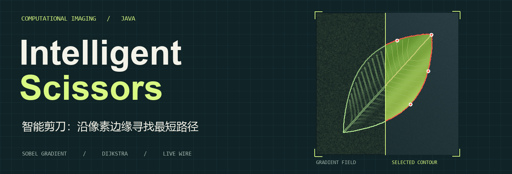
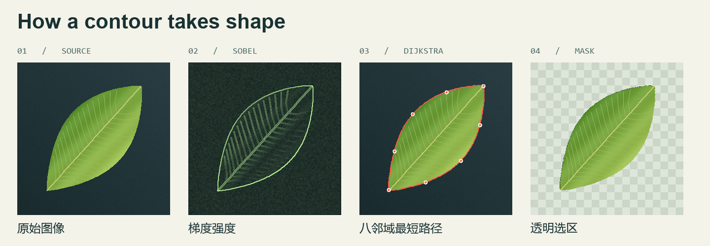
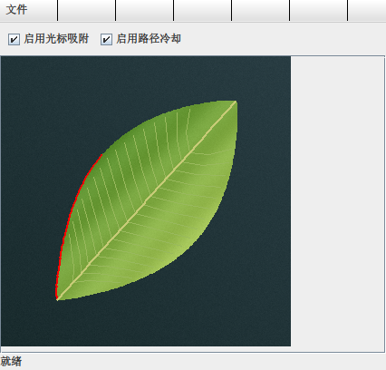

**Intelligent Scissors** 是一个 Java Swing 交互式抠图工具。你在物体边缘点下锚点，它在锚点与光标之间寻找一条贴着边缘的路径。沿轮廓走一圈，就能把选区保存为透明 PNG。

[看算法过程](#一片叶子的轮廓是怎么算出来的) · [运行项目](#运行项目) · [试用叶片样图](leaf-sample.png)

## 一片叶子的轮廓是怎么算出来的？



上图使用仓库自带的 [320 × 320 叶片样图](leaf-sample.png)。梯度、路径和透明选区均由本项目的 Java 类计算。白点标出这次演示使用的 8 个锚点，红线连接相邻锚点，棋盘格表示透明区域。

| 阶段 | 从图中看什么 | 对应实现 |
| --- | --- | --- |
| 读出边缘 | Sobel 算子分别计算水平与垂直方向的亮度变化。叶缘最亮，叶脉也留下了较弱的线。 | [ImageProcessor.java](dsbb_project/src/ImageProcessor.java) |
| 沿边寻路 | 每个像素与周围最多 8 个像素相连。走入下一像素的代价为 `1 / (1 + 梯度强度)`。Dijkstra 从锚点计算累计代价最低的路径，所以红线可以绕着叶缘弯曲。 | [PathFinder.java](dsbb_project/src/PathFinder.java) |
| 闭合并抠图 | 各段路径拼成多边形，只将选区内的原始像素画入透明画布。输出保留原图尺寸。 | [CroppingUtils.java](dsbb_project/src/CroppingUtils.java) |

**为什么还需要锚点？** 叶脉和外轮廓都是边缘。如果预览线沿叶脉抄了近路，就在想保留的叶缘上补一个锚点，让下一段路径从那里重新出发。

## 运行项目

准备 **JDK 11 或更高版本**。仓库内含所需的 `algs4.jar`。从仓库根目录运行以下命令，启动类为 `IntelligentScissorsGUI`。

**Windows PowerShell**

```powershell
cd dsbb_project
New-Item -ItemType Directory -Force build | Out-Null
$sources = (Get-ChildItem src -Filter '*.java').FullName
javac -encoding UTF-8 -cp algs4/algs4.jar -d build @sources
java -cp "build;algs4/algs4.jar" IntelligentScissorsGUI
```

<details>
<summary>macOS / Linux 命令</summary>

```sh
cd dsbb_project
mkdir -p build
javac -encoding UTF-8 -cp algs4/algs4.jar -d build src/*.java
java -cp "build:algs4/algs4.jar" IntelligentScissorsGUI
```

</details>

## 试一次贴边抠图



1. 选择 **文件 → 打开图像**，打开仓库根目录的 `leaf-sample.png`。
2. 单击叶缘设置第一个锚点，再沿边缘移动光标。观察红线，在转弯处单击，确定当前路径段。
3. 绕回起点附近，双击闭合轮廓。在弹出的抠图窗口点击 **保存**，使用带 `.png` 后缀的文件名。

当前版本建议先用**方形图片**体验。路径数组的初始化按图像高度遍历第一维，处理非方形图片时可能出现路径不完整或数组越界。
